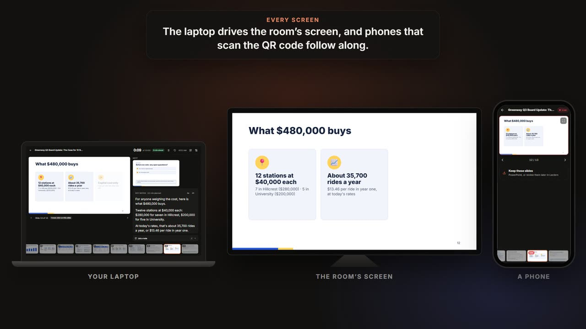
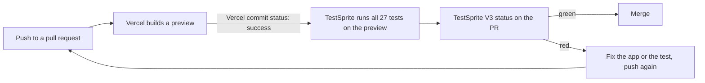

# Lectern

**Slides that know what to say.** Lectern turns your notes into a deck where every slide carries its own script, cues, timing and likely question. The deck you build is also what you rehearse with.

**Live:** https://lectern-sooty.vercel.app (no sign-up) · **Tests:** every pull request is tested end to end by [TestSprite](#tests-that-run-themselves-the-testsprite-loop) · Built for the TestSprite Hackathon, Season 4.

[](https://lectern-sooty.vercel.app/welcome#tour)

*A 124-second narrated recording. It plays the sample talk, then, live on the site, Claude Opus turns two sample files and a brief into a deck, the deck assistant changes it, and three screens play it. The AI’s waits are cut, and each cut is labelled. Click the picture to watch it on the intro page, or [download the video](lectern/public/media/lectern-tour.mp4) (7.8 MB).*

## The problem

A talk is two jobs. First you build the slides. Then you rehearse them, usually from a separate notes document, a printout or memory. Both take hours. Most people would rather spend that time on the work the talk is about, or on something else entirely.

## How Lectern cuts that time

### Building the deck

- **Notes become a deck, with no AI.** Paste an outline or rough notes, or open a Markdown, Word or PowerPoint file. Each heading starts a slide and picks its type: "Key terms" makes key-term slides, a numbered list makes steps, a Markdown table makes a table. Short lines go on the slide and longer prose goes into the script. Every slide gets a starter script, key points and planned minutes, timed at 130 spoken words a minute. Try it on the [intro page](https://lectern-sooty.vercel.app/welcome#from-notes) or [in the app](https://lectern-sooty.vercel.app/decks?new=notes).
- **The layout is done for you.** Auto style picks the look from what the deck is for and who it's for, and picks each slide's layout from its content. The studio warns when a slide holds more words than its audience should read.
- **AI drafting, with a free allowance per person.** Give a topic, the audience and any material, and Claude (`claude-opus-5-5`) drafts the whole deck, key notes included. Before you see it, every slide is checked against Lectern's layout rules with the real fonts. Slides that don't fit go back to Claude to be shortened, or are split.
  - With accounts switched on, AI asks people to sign in, and each account starts with 4,000 free credits ($20 of AI use). Each request takes what it really cost in tokens. When the credits run out, AI stops for that person and everything else keeps working.
  - On the live site, AI is on today. Accounts are built and tested, but not switched on there yet: they need the site's Supabase keys.

### Rehearsing

Every slide has **key notes**: a script, the key points, cues ("Pause", "Show the number"), one likely question with its answer, and the minutes it should take. You write them once, next to the slide. The same notes then feed every way of rehearsing and presenting:

| Where | What you get | Try it |
|---|---|---|
| Study mode | Read each slide with its key points, answer the likely question, flip flashcards, or read a one-page summary. Progress is saved. | [Study the sample talk](https://lectern-sooty.vercel.app/try/talk/study) |
| Teleprompter | The script scrolls at your speaking pace, and can be mirrored. **Share to phones** puts it on your phone, which then also moves the slides. | [Open the teleprompter](https://lectern-sooty.vercel.app/try/talk/prompter) |
| Presenter view | The script and cues, the next slide, a clock, and how far ahead or behind you are. | [Open presenter view](https://lectern-sooty.vercel.app/try/talk/presenter) |
| Handout | The key notes on paper or as a PDF. | [Print the handout](https://lectern-sooty.vercel.app/try/talk/print) |
| PowerPoint | The script goes into the .pptx speaker notes. | Export menu in the studio |

So you rehearse from the deck itself. There's no second document to write, keep in step with the slides, or lose.

## Features

Every link below works in a fresh browser. A `/try/...` link puts the sample deck back first if it was deleted.

- **[Intro page](https://lectern-sooty.vercel.app/welcome):** a playable sample talk, the tour video and a phone quiz.
- **[Studio](https://lectern-sooty.vercel.app/try/talk/studio):** 37 slide types on a 16:9 canvas. The slide is the editor, as in Canva or PowerPoint: type into any text, drag things to move them, pull a corner to resize, and pick a layout from the toolbar beside what you selected. Drop in pictures and video, and undo anything. Every change saves on its own.
- **[Present](https://lectern-sooty.vercel.app/try/talk/present):** click-to-reveal steps. The audience view, presenter view and teleprompter stay in sync.
- **Share to phones:** two QR codes. Your phone becomes a teleprompter and remote. Everyone else follows the slides, votes in polls and plays a live quiz with a leaderboard.
- **[A quiz in a link](https://lectern-sooty.vercel.app/welcome#phone-quiz):** the questions travel inside the link, so each phone runs the quiz on its own.
- **[Make a deck from a file](https://lectern-sooty.vercel.app/make):** a Markdown, Word or PowerPoint file in, slides out. With AI on, a topic is enough.
- **Pictures:** search Openverse and Wikimedia Commons for pictures you may reuse. Each one keeps its source, author and licence for the credits slide.
- **[Courses](https://lectern-sooty.vercel.app/try/course):** weeks of lessons, each with its deck, on a schedule you can export to your calendar.
- **Recordings:** record a class or drop in a file. Whisper transcribes it in the browser, so the audio never leaves your device.
- **Export:** PowerPoint with editable charts and tables, one .html file that works offline, and a printable handout.
- **Local-first:** decks, notes and recordings are saved in your browser (IndexedDB). After one visit the app opens offline.

The full feature list, the outline format, mods and how each part works are in [`lectern/README.md`](lectern/README.md).

## Tests that run themselves: the TestSprite loop

### How it's wired



1. A push to a pull request makes Vercel build a preview at `https://lectern-git-{branch-slug}-freddy-tamas-projects.vercel.app`.
2. The TestSprite GitHub App is installed on `freddy-tama`. Its trigger listens for the Vercel commit status, so tests start as soon as the preview is ready.
3. TestSprite's cloud browsers run the whole suite against that preview URL. A full run takes about 4 minutes.
4. The result comes back as the `TestSprite V3` commit status: "27 tests queued", then "All 27 tests passed" or, for example, "26/27 passed · 1 failed".
5. **Merge gate:** on in TestSprite, so a failing run reports a failing status. GitHub doesn't enforce it yet: `main` has no branch-protection rule (`gh api repos/freddy-tama/lectern/branches/main/protection` answers "Branch not protected"). The rule we follow is no merge on red.

Draft pull requests aren't tested. Branch names stay at or under 29 characters after slugging, because Vercel shortens preview hostnames longer than 63 characters and the URL pattern would stop matching.

### What the suite covers

The suite was planned in the TestSprite 3.0 portal from [`lectern/docs/testsprite-prd.md`](lectern/docs/testsprite-prd.md). That file lists Lectern's flows with the exact text, URLs and `data-testid`s that count as a pass. TestSprite's planner proposed 83 tests. Many repeated each other, and every pull request re-runs the whole suite on a free plan, so the plan was cut to one test per behaviour: **27 tests**.

| PRD flow | Tests | What counts as a pass (from the PRD) |
|---|---|---|
| 1. First visit | WLC-006 | A fresh visit to `/` lands on `/welcome`, with one `h1` and the "At a glance" list. |
| 2. The sample talk on the intro page | PRS-001, PRS-002, PRS-003 | Next goes from "Slide 4 of 17 · click 0 of 1" to "click 1 of 1", then "Slide 5 of 17". Show answer sets `aria-expanded`. Audience and presenter views swap. |
| 3. Present | WLC-002, PRS-007 | The arrow keys move through the show. `/try/talk/present` starts it, and Escape goes to the studio. `/try/nope` shows "Nothing here". |
| 4. Phone quiz | QIZ-001 | The quiz carried in the link: "Question 1 of 3", three answers, a score of the form "N/3". |
| 5. From notes, with no AI | NTS-001, NTS-002 | Notes become a deck for a talk audience. The AI tab says AI isn't set up. |
| 6. Key notes in five places | KNT-001, KNT-002, KNT-003, REV-001 | The key-notes tabs, opening presenter view and the teleprompter from them, and reading a deck in review mode. |
| 7. Uses and the sample course | PRS-004, PRS-005, CRS-001 | The sample report and lesson open in present mode. A lesson's deck opens from the course schedule. |
| 8. Theme | THM-001 | The theme button cycles system, light and dark. |
| 9. Getting started | WLC-001, WLC-003, WLC-004, WLC-005, PRS-006 | `/start` and each of its paths. After opening the sample talk, `/` shows Home, not the intro page again. |
| 10. Decks and the studio | DCK-001, DCK-002, STD-001, STD-002 | The six sample decks are listed and searchable. A title edit survives a reload. A slide can be added. |
| 11. Make a deck without AI | DRF-001 | A topic alone, with no AI, must not make an empty deck announced as "Your deck is ready". |

Every test starts in a fresh browser profile and checks exact text and URLs, not "the page loaded". The suite leaves out what needs a second device, a microphone, a large model download, a paid AI key or a real sign-in. Flow 12, sign-in for AI, has no test yet.

### History

Times are China time (UTC+8). The full record, with every step and run link, is [`lectern/docs/testsprite-log.md`](lectern/docs/testsprite-log.md).

| When | What happened | Result | Credits |
|---|---|---|---|
| Oct 21, 21:35 | Project set up from the PRD. 10 agents explored the live site in 6½ minutes. The PR trigger and the merge gate were turned on. | 83 tests proposed, cut to 27 | 6.5 |
| Oct 21, 21:56 | **Run 1, on production.** It found a real bug: on `/make`, with no AI, a topic alone built an empty one-slide "New deck" and said "Your deck is ready". The other failures were test mistakes. For example, the report test clicked the hero's "Present the sample talk" instead of the Uses section's link to `/try/report/present`. | 21 passed, 4 failed, 2 blocked | 13.5 |
| Oct 21, 22:11 | The five wrong tests were rewritten to name the exact link text, href or section, and re-run one by one. The suite now failed only on the real bug, which was the right result. | 5 of 5 passed | 2.5 |
| Oct 21, 23:07 | **[#8](https://github.com/freddy-tama/lectern/pull/8), the `/make` fix.** DRF-001 went from red on production to green on the PR's preview. A loosely generated test, PRS-006, failed. It was rewritten to follow PRD flow 9 step by step and passed on production at 23:22. A pull request's run can't be re-run from the dashboard, so #8's own check stayed red. | 26 of 27 passed | 13.5 + 0.5 |
| Oct 22, 00:14 | **[#9](https://github.com/freddy-tama/lectern/pull/9), sign-in for AI** (accounts, 4,000 free credits each, study progress per person). It carried #8's commits, so the `/make` fix and the rewritten PRS-006 were both green here. #8 merged with it. | All 27 passed | 13.5 |
| Oct 22, 00:41 | **[#10](https://github.com/freddy-tama/lectern/pull/10)**, the license and the README's first testing section. | All 27 passed | 13.5 |
| Oct 22, 01:59 | **[#11](https://github.com/freddy-tama/lectern/pull/11), the animated pitch and the tour video.** The intro page changed around the tested controls. No test was edited, and none broke. | All 27 passed | 13.5 |
| Oct 22, 02:08 | **[#12](https://github.com/freddy-tama/lectern/pull/12), the "compiled grammar is too large" fix** for AI drafting on `/make`. Previews have no AI key, so the suite checked that nothing else broke. The fix itself is covered by vitest. | All 27 passed | 13.5 |
| Oct 22 | **[#13](https://github.com/freddy-tama/lectern/pull/13), this README.** The result is on the PR's `TestSprite V3` check. | See the PR | about 13.5 |

Before #13, the setup and 12 runs had used 90.5 of the free plan's 150 monthly credits. Run 1 found the one real bug so far. Its fix went through the gate on its own PR, and every PR after that has passed all 27 tests.

### Unit and integration tests (vitest)

`npm test` runs 625 tests in 45 files, in Node and jsdom. They need no keys and no network: the Claude API, Supabase and the picture services are stood in for. They cover outlines and drafting, layout and fitting, PowerPoint export, import from Word, PowerPoint and Markdown, the service worker, sharing and the quiz, each AI endpoint's requests and refusals, AI credits, and [`supabase/schema.sql`](lectern/supabase/schema.sql) run in a real Postgres (PGlite) to check its row-level security.

## Run it locally

You need Node 22.12 or newer. The app lives in [`lectern/`](lectern):

```bash
cd lectern
npm install
npm run dev
```

The dev server opens at http://127.0.0.1:5180 and serves the API functions too. A first visit loads three sample courses and six sample decks.

| Command | What it does |
|---|---|
| `npm test` | The vitest suite. |
| `npm run typecheck` | TypeScript, with no output files. |
| `npm run build` | Type-checks, then builds to `dist/`. |

Everything except AI works with no settings. To turn more on, put these in `lectern/.env.local`, or in Vercel's environment variables:

- **AI:** `ANTHROPIC_API_KEY` turns on drafting, class notes from recordings, activities and drawings. `LECTERN_MODEL` changes the model, and `LECTERN_ACCESS_CODE` asks visitors for a code first.
- **Accounts and AI credits:** `SUPABASE_URL`, `SUPABASE_PUBLISHABLE_KEY` and `SUPABASE_SECRET_KEY`. `LECTERN_DAILY_CREDITS` caps what everyone together may spend in a day.
- **AI pictures:** `OPENAI_API_KEY` or `GEMINI_API_KEY`, with `LECTERN_IMAGE_PROVIDER` and `LECTERN_IMAGE_MODEL` to choose.
- **Picture search:** `PEXELS_API_KEY`, `OPENVERSE_CLIENT_ID` and `OPENVERSE_CLIENT_SECRET`, all optional.

What each one does, and how to set up accounts, is in [`lectern/README.md`](lectern/README.md#deploy-to-vercel).

## Stack

Vite 8, React 19 and React Router 7, Dexie (IndexedDB), pptxgenjs, PeerJS, Transformers.js (Whisper), Vercel functions calling the Claude API, Supabase for the optional accounts, and vitest.

## What's next

- Switch accounts on for the live site, so the 4,000-credit allowance applies there.
- Add TestSprite tests for sign-in (PRD flow 12). Three are planned: ACC-001 to ACC-003.
- Let DRF-001 and NTS-002 also accept the AI-on and sign-in states, so the suite passes against production too, which now has AI on. Pull request previews have AI off, so PR runs aren't affected.
- Have GitHub enforce the merge gate with a branch-protection rule on `main`.
- Link a lecture's transcript to the slides it covers.
- Share a deck's study mode with learners.

## License

All rights reserved. See [`LICENSE`](LICENSE). The source is public so it can be read and evaluated, including by the hackathon judges. Any other use needs written permission.
